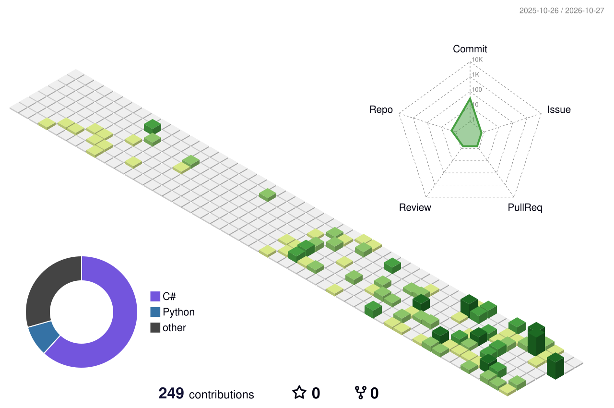

  

<h1 align="center">Klock / LKyoona</h1>

<strong>Full-Stack Development · Reverse Engineering · Deployment &amp; Automation</strong>

全栈开发 · 逆向分析与重构 · 部署运维与自动化

## About

我是 **Klock**，主要做 Web 全栈、Windows 客户端和 Python 自动化，也参与 Linux 服务部署、网络代理排障与程序逆向分析。项目覆盖公开与闭源开发，关注功能实现，也关注系统如何运行、问题如何定位和修复。

- **全栈与客户端**：React / Vue / Nuxt，Go / Python / PHP；Rust / Tauri、C# / .NET / WPF，结合 MySQL、Redis 与外部接口完成业务和系统集成。
- **部署与自动化**：Linux、SSH、证书与服务维护，网络和代理排障；使用 Python、PowerShell / Bash、GitHub Actions 编写工具与交付流程。
- **逆向与重构**：使用 IDA Pro / Hex-Rays 分析 Mach-O 动态库，梳理控制流、数据结构与 IPC 协议；使用 C/C++、CMake、测试 Harness 和 Python 验证程序重构并验证相关逻辑。

## Stack

**Languages**

<picture>
  <source media="(prefers-color-scheme: dark)" srcset="https://skillicons.dev/icons?i=c,cpp,rust,cs,python,go,ts,js,php&amp;perline=9&amp;theme=dark" />
  
</picture>

**Desktop &amp; Web**

<picture>
  <source media="(prefers-color-scheme: dark)" srcset="https://skillicons.dev/icons?i=tauri,dotnet,react,vue,nuxtjs,flask&amp;perline=6&amp;theme=dark" />
  
</picture>

**Data &amp; Tooling**

<picture>
  <source media="(prefers-color-scheme: dark)" srcset="https://skillicons.dev/icons?i=mysql,redis,git,githubactions,powershell,bash&amp;perline=6&amp;theme=dark" />
  
</picture>

Libraries &amp; tools

- **逆向与验证**：IDA Pro / Hex-Rays、CMake、C/C++ Harness、Python 验证脚本。
- **系统与桌面**：Tokio、Win32 API、Windows Service、IPC、WPF、LibVLCSharp。
- **Web 与数据**：ThinkPHP、Element Plus、Pinia、ECharts、HTTPX、requests、PyMySQL、CCXT。
- **工具与集成**：PyQt5、Tkinter、Pygame、Telethon、python-telegram-bot、IMAP / POP3。

## Contribution landscape

公开与私有贡献按 GitHub 日历生成；更多开发工作在闭源工程与本地项目中进行。

<picture>
  <source media="(prefers-color-scheme: dark)" srcset="profile-3d-contrib/profile-night-rainbow.svg" />
  
</picture>

### Contribution snake

<picture>
  <source media="(prefers-reduced-motion: reduce) and (prefers-color-scheme: dark)" srcset="profile-3d-contrib/profile-night-rainbow.svg" />
  <source media="(prefers-reduced-motion: reduce)" srcset="profile-3d-contrib/profile-green.svg" />
  <source media="(prefers-color-scheme: dark)" srcset="dist/github-contribution-grid-snake-dark.svg" />
  
</picture>

## Connect

QQ：`438396211` · **Together to Deep Learning!**
